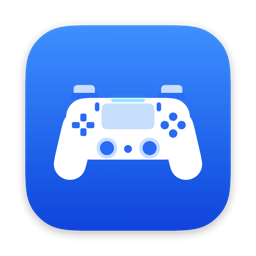
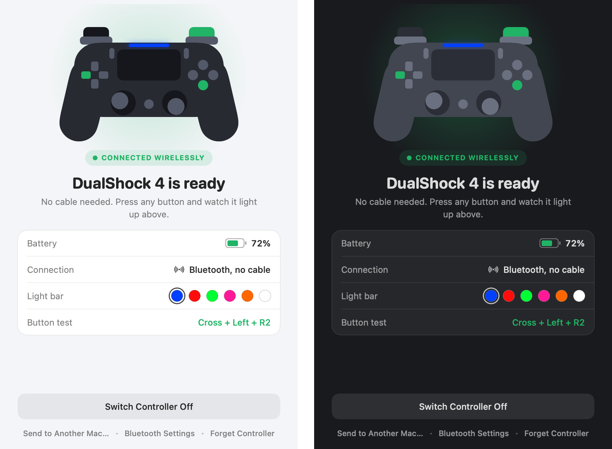
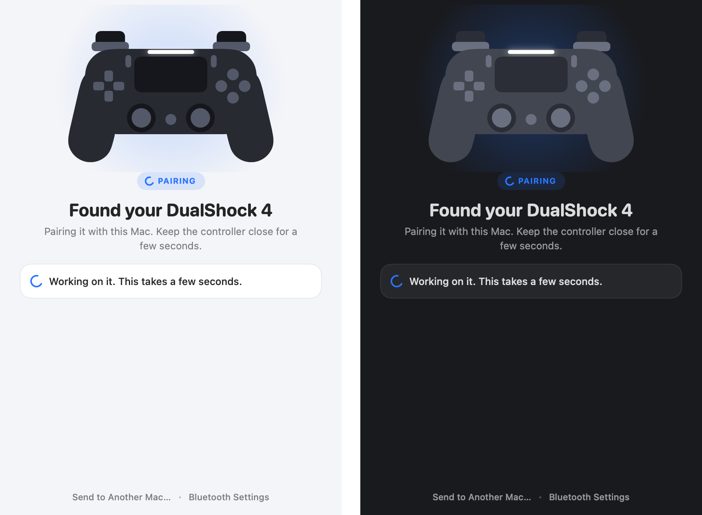

<p align="center">
  
</p>

<h1 align="center">DS4Link</h1>

<p align="center">
  Connect a PS4 controller to your Mac in one go, and check that every button works.
</p>

<p align="center">
  <a href="https://github.com/nizarmasri/DS4Link/releases/latest"><strong>Download for macOS</strong></a>
  &nbsp;·&nbsp;
  <a href="#features">Features</a>
  &nbsp;·&nbsp;
  <a href="#build-from-source">Build from source</a>
</p>

<p align="center">
  
</p>

## Why

macOS supports the DualShock 4, but getting one connected through Bluetooth settings is fiddly. You have to know the button combo, the controller only remembers one device at a time, and a PS4 in the next room can grab it before your Mac does. When it doesn't work, there's no hint as to why.

DS4Link walks you through it. Open the app, hold SHARE + PS, and it finds, pairs and connects the controller for you. If something gets in the way, it tells you what's wrong and what to do about it.

## Features

- **Guided pairing.** Clear steps for putting the controller in pairing mode, with tips for the usual problems (slow-pulsing light, a nearby PS4, a controller paired elsewhere).
- **Reconnects by itself.** Once it's paired, just press PS.
- **Button test.** Press any button and watch it light up on screen. A quick way to check a second-hand controller or find a dead button.
- **Status at a glance.** Battery level, Bluetooth or cable, and a light bar colour you can change.
- **Switch the controller off** from your Mac, or forget it if you want to start over.
- **Send to another Mac.** One click packs the app and the setup steps into a zip you can AirDrop.
- Works with the PS5 DualSense too (hold CREATE + PS).
- Once connected, the controller works in any Mac game or app that supports controllers.
- Bluetooth is only used to talk to your controller. Nothing leaves your Mac.

<p align="center">
  
</p>

## Install

1. Download `DS4Link-1.0.0-macOS.zip` from the [latest release](https://github.com/nizarmasri/DS4Link/releases/latest).
2. Unzip it and drag **DS4Link** into your Applications folder.
3. Open it. The first time, macOS says it can't verify the app because it isn't notarized. Open **System Settings → Privacy & Security**, scroll down and click **Open Anyway**.
4. Click **Allow** when macOS asks for Bluetooth access.

Works on macOS 13 or later, on both Apple silicon and Intel Macs.

## Connecting the controller

1. Start with the controller off (light bar dark).
2. Hold **SHARE** and **PS** together for about 3 seconds, until the light bar flashes quickly in double blinks.
3. DS4Link takes it from there.

A controller remembers only one device at a time. If you've used it with a PS4 or another computer since, do the SHARE + PS step again. Still stuck? Press the small reset button on the back, next to L2, with a paperclip for 5 seconds.

## Build from source

You'll need Xcode 16 or later.

```sh
scripts/build.sh
```

This builds a universal app, installs it to `~/Applications/DS4Link.app`, and writes `build/DS4Link.zip` for sharing. `swift test` runs the tests.

There's also a command-line mode for debugging: `DS4Link --cli status | scan | auto | pair <address> | connect <address> | disconnect <address> | forget <address>`. Logs go to `~/Library/Logs/DS4Link/ds4link.log`.

The app is signed ad hoc by default. To keep the Bluetooth permission across rebuilds, sign it with your own certificate (set `SIGN_IDENTITY` or put the identity name in `scripts/.signing-identity`).

## License

MIT

PlayStation, PS4, DualShock and DualSense are trademarks of Sony Interactive Entertainment. DS4Link is an independent project and isn't affiliated with Sony.
